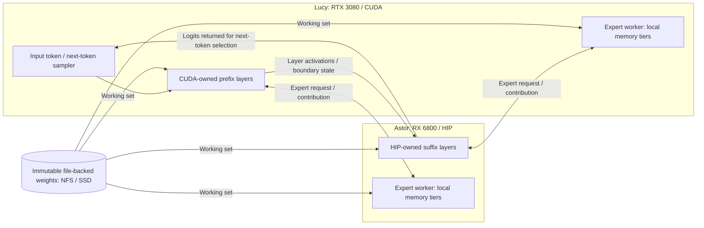

# Experimental distributed inference in this fork

This fork of [Strata](https://github.com/Niko1221/Strata) has completed autoregressive
decoding with one model split across NVIDIA/CUDA and AMD/HIP computers. Layer
owners transfer activations and the required boundary state across the network;
the generated token feeds back into the same distributed model for the next step.
Both machines can also serve remote expert calls while file-backed weights supply
their resident working sets. The completed DeepSeek and Kimi runs are documented
below, with their different execution and quality limits.

The purpose is to run models that exceed one machine's resident memory. Speed and
quality refinement are deferred; working inference is the current milestone.

This is source-checkout research in [ztripez/Strata](https://github.com/ztripez/Strata).
It is not a feature of the upstream desktop installer, a portable cluster product,
or support for arbitrary GGUF architectures. Existing upstream app instructions
elsewhere in this repository describe a separate, released experience.

## What has actually run

| Model / weights | Observed execution | Evidence and limits |
| --- | --- | --- |
| Qwen3.6-35B-A3B, UD-Q4_K_XL | CUDA primary with HIP remote experts; bounded expert parity, decode and worker-loss trials | [Qwen report](DISTRIBUTED_EXPERTS.md#validation-and-remaining-work). Includes 11 expert comparisons and 32-token decode/logit checks. This does not establish universal token identity or a general speedup. |
| DeepSeek V4.1 Flash, ISTA-DAS 2.00-bpw | Whole layers split across AMD/NVIDIA, remote CPU experts in both directions, four complete 2K requests using NFS and staged backing; a separate HTTP demo answered fresh questions | [2K measurements](DEEPSEEK_CAPACITY_PERFORMANCE.md), [quality checkpoint](DEEPSEEK_EXPERIMENTAL_CHECKPOINT.md), [public acceptance record](../evidence/deepseek/experimental-acceptance.json). Strict E5 failed; experimental acceptance retained all four baseline task passes. |
| DeepSeek V4.1 Flash, Unsloth UD-IQ3_XXS | Complete 394.74 GB model: layer-only and hybrid each consumed 1,900 prompt tokens and generated 148 tokens; bidirectional remote experts, zero fallbacks, monitored memory fit | [Q3 report](DEEPSEEK_Q3_CAPACITY.md), [public execution receipt](../evidence/deepseek/q3-vertical-inference.json). Vertical execution complete. Separate task retention failed on answer formatting; hybrid quality comparison was not run. |
| Kimi K2 Instruct, Unsloth UD-IQ3_XXS | Complete 416.62 GB checkpoint, all 61 layers, 27-token chat prompt followed by two autoregressive tokens: **Hi there**; bidirectional remote experts and clean exits | [Kimi guide](KIMI_K2.md), [public receipt](../evidence/kimi-k2/vertical-inference.json). A short full-model demonstration, not a 2K, general quality, capacity or speed qualification. |

DeepSeek Pro-0813 is a download/adapter target, not a proven execution path.
DeepSeek V4.1 Flash Q4 is downloaded but has not been qualified here. Kimi K3 is
research only. Qwen3.8's upstream availability does not establish distributed
validation in this fork. Do not count these as demonstrated fabric models.

The experiments used Lucy (RTX 3080 10 GB, Ryzen 5900X, 64 GiB RAM) and Astor
(RX 6800 16 GB, Ryzen 3900X, 64 GiB RAM), with a 10GbE path and shared NFS
backing on pve01. These machines do not hold the entire large checkpoint in VRAM
or RAM. SSD/NFS mappings supply weights outside the resident working set.

## How execution is distributed

The Kimi K2 demonstration used the direction shown below: CUDA on Lucy owns the
prefix and HIP on Astor owns the suffix. The measured DeepSeek placements used
the reverse layer-owner direction. Each diagram arrow describes data movement,
not a transfer of GPU pointers or a copy of the complete model.

The solid layer path and token feedback form one autoregressive inference loop.
Expert calls are separate exchanges in either direction. A worker's local tiers
depend on the configured model path; this diagram does not imply that remote
experts ran on GPUs in every recorded experiment.

A layer owner runs its assigned dense attention, routing and shared-expert work.
At the partition boundary it sends activation/state records to the next owner;
that owner keeps the mutable state for its own layers. A model-specific adapter
establishes which state must cross the cut. A GGUF file split is a storage split,
not automatically an executable layer boundary.

Selected expert work can be sent separately to an expert worker. The worker
returns a contribution; the layer owner combines it in the model's required order.
NFS supplies immutable backing weights. It is not the activation transport, and
weights are not copied across the expert RPC on each token.

Layer and expert assignments are installed before execution and remain fixed for
the worker session. There is no live expert migration or automatic global
rebalancing. Local GPU residency and CPU/mapped execution are separate from that
ownership. A locally resident expert can execute locally despite remote ownership.
The bounded DeepSeek layer path disabled adaptive expert caching; its Q3 run used
zero expert VRAM budgets, small worker RAM arenas and file-backed execution.
The OS page cache still changes as weights are accessed.

A failed expert request can be recomputed locally when its weights are accessible.
A lost layer owner aborts the request: attention/KV state is mutable, so the fabric
does not silently replay the request or promise transparent failover.

## Build and reproduction

These paths are opt-in. Use the existing CUDA/HIP toolchain and enable
`STRATA_NATIVE_EXPERTS=ON` and `STRATA_NETWORK_EXPERTS=ON`. Relevant experimental
targets include `strata-expert-worker`, `strata-deepseek-layer`,
`strata-kimi2-split` and `strata-kimi2-expert-worker`. A build does not establish
model execution or quality; see each model's recorded commands and receipts.

- [Qwen setup and validation](DISTRIBUTED_EXPERTS.md)
- [DeepSeek native process and HTTP adapter](DEEPSEEK_LAYER_PROCESS.md)
- [DeepSeek worker VRAM/RAM/mapped tiers](DEEPSEEK_EXPERT_TIERS.md)
- [Kimi profile preparation and measured launcher](../tools/kimi-k2/README.md)
- [Shared hardware reservations](HARDWARE_LOCK.md)

The recorded launchers contain homelab-specific paths and addresses. They need
adaptation to another installation. No one-command distributed installer or Kimi
HTTP integration is claimed. The control-plane schemas, staging and lifecycle
checks exist, but automatic measured-cost whole-layer placement is unqualified.
The old offline optimizer is an assumptions-based draft, not a proven scheduler.

## Current limitations

- Linux CUDA/HIP is the demonstrated fabric environment. Other platforms/backends
  and unrelated models are not qualified by these results.
- Full checkpoint execution means all required model layers execute; it does not
  mean all weights are resident or every expert is selected by a short prompt.
- DeepSeek's accepted experimental quality checkpoint had 98.9% top-1 agreement
  over 1,000 teacher-forced positions, below its original 99% criterion. CPU-backed
  hybrid raw logits matched layer-only in that corpus. Remote GPU expert quality
  remains unqualified.
- Q3's prime task returned `{"answer":true}` instead of the required bare `true`.
  The exact-answer failure remains recorded. No improved-quality claim follows
  from using a higher-fidelity quantization.
- Kimi's proof is two generated tokens, not a completed conversation or benchmark.
  Native process lifetimes were roughly two hours including setup, prefill,
  generation and cleanup. They are not a decode-throughput measurement.
- Whole-model streaming can be very slow. Existing single-run timings are not
  controlled speedup claims. No speed target is required for vertical completion.
- Native process/session recovery checks do not establish production readiness,
  secure multi-tenant networking or transparent layer-worker recovery.
- Raw arrays, binaries and many historical captures remain on the homelab storage.
  Public receipts/reports describe their scope; this is not a fully portable,
  independently reproduced benchmark bundle.

Original failures and strict gate results remain in the model reports. The
chronological [fabric status log](DISTRIBUTED_FABRIC_STATUS.md) is supporting
history; use this page for the public overview and per-model evidence for detail.

## Merged-source verification

[The integration receipt](../evidence/fabric-merge/validation.json) records CUDA
and HIP/gfx1030 builds of the DeepSeek layer process, generic expert worker,
Kimi split process and Kimi expert worker. Three focused C++ protocol tests and
31 synthetic host/installation tests passed. These are merged-source build and
control checks, not new full-model executions. The hardware demonstrations above
were recorded before integration; no claim of a post-merge inference rerun is made.
